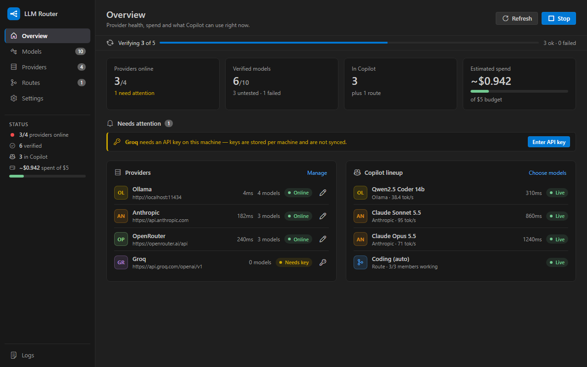
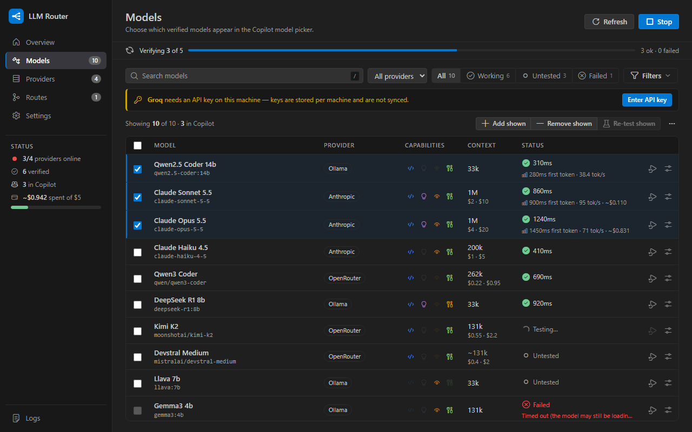
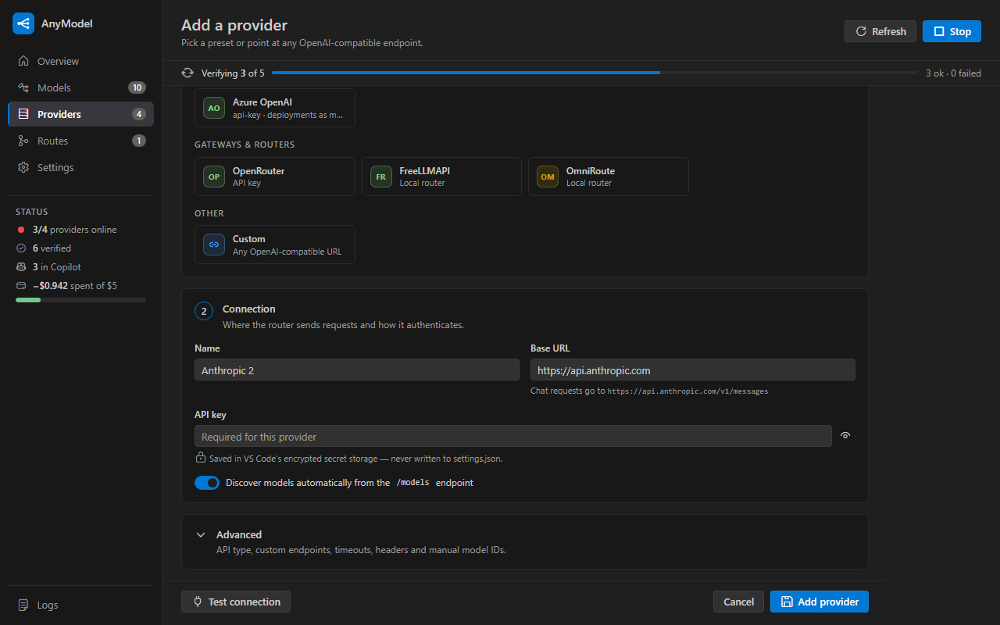

# AnyModel — Custom LLMs in Copilot Chat

[](https://github.com/aravind9643/vscode-anymodel/actions/workflows/ci.yml)
[](https://code.visualstudio.com/)
[](https://code.visualstudio.com/api/extension-guides/ai/language-model-chat-provider)
[](https://opensource.org/licenses/MIT)

Use **local and third-party models in GitHub Copilot Chat**. **AnyModel** registers Anthropic (Claude), Azure OpenAI, Ollama, LM Studio, vLLM, LocalAI, OpenRouter, OpenAI, Gemini, DeepSeek, Groq, Together, Mistral, GitHub Models, FreeLLMAPI, OmniRoute, or any OpenAI-compatible server as a native VS Code language model provider. You get streaming, tool calling (agent mode), image input and reasoning output.



## Features

- **Dashboard**: an Overview page with provider health, spend against your budget, items that need attention and the current Copilot lineup; plus Models, Providers, Routes and Settings pages. It follows your VS Code theme, including high contrast.
- **Native in Copilot**: the models you pick appear in the Copilot Chat model picker under *AnyModel*.
- **Native VS Code BYOK Sync (`chatLanguageModels.json`)**: export your models directly to VS Code's native `chatLanguageModels.json` with 1-click append or background auto-sync, complete with automatic `.bak` safety backups.
- **Three wire protocols**:
  - **OpenAI-compatible**: most servers.
  - **Ollama native** (`/api/chat`): sends the context length (`num_ctx`) so long chats aren't cut short, plus keep-alive and native thinking.
  - **Anthropic Messages API**: uses the official SDK, with model limits from the Models API, summarized adaptive thinking, and refusal fallbacks on supported models.
- **Smart Fallback Routes**: combine several models into one picker entry with automatic failover (e.g., local first with cloud backup). 1-click **Auto-Generate Routes** creates balanced fallback tiers like *Cost Saver*, *Coding & Reasoning*, and *Balanced*.
- **Multi-Provider & Gateway Support**: automatic sub-provider mapping for aggregators like OpenRouter and OmniRoute (Moonshot, DeepSeek, Zhipu, MiniMax, Baichuan, Qwen, etc.), with hierarchical filtering and upstream diagnostics.
- **Local Server Auto-Scan**: 1-click scan discovers locally running engines on your machine (Ollama on 11434, LM Studio on 1234, vLLM on 8000, LocalAI on 8080).
- **Health-checked & Tool-tested**: each model gets a quick chat check. With the full check it is also asked to call a tool, and the result is shown as *calls tools*, *accepts tools but ignores them*, or *no tool support*. Broken models never reach the picker.
- **Accurate limits**: real context windows are read from Ollama (`/api/show`) and LM Studio. You can override the name, context window, max output, tool support, vision and reasoning for any model, and guessed values are marked `~`.
- **Cost & Budget Management**:
  - Set a monthly spend budget with visual meters and proactive warning alerts.
  - Before checking many models on remote (possibly paid) providers, it asks first and offers to check only your selected models. A *basic* mode halves the number of requests.
  - Bulk checks are rate-limited per provider with jittered exponential backoff for 429/5xx responses.
  - Prices come from OpenRouter or Anthropic's list prices and can be overridden per model. Spend is estimated from reported usage.
- **Real performance stats & Telemetry**: time to first token (TTFT) and tokens per second, measured from your actual chats. Export analytics as JSON or CSV anytime.
- **Calibrated token counts**: learned from the usage numbers the server reports, so Copilot trims context at the right point.
- **Ollama extras**: pull models from the dashboard or sidebar, and keep models loaded with a per-provider keep-alive.
- **Secure keys**: API keys and credential-like header values live in VS Code's encrypted secret storage, never in `settings.json`. Keys are stored per machine.
- **Sidebar and dashboard**: an Activity Bar view with each provider's health and per-model checkboxes, plus a dashboard with instant `@tag` filters (`@tools`, `@coding`, `@reasoning`, `@vision`, `@fast`), search keyboard shortcuts (Ctrl+F / Cmd+F), 1-click model ID copy, and smooth scrolling for thousands of models.

## Getting started

1. Install the `.vsix`:
   ```bash
   code --install-extension vscode-anymodel-1.0.0.vsix --force
   ```
2. Open the **AnyModel** view in the Activity Bar and click **Add Provider**.
3. Pick a preset (or *Custom*), enter the API key if needed, then click **Test connection** and **Add provider**.
4. Click **Verify untested** to health-check the discovered models.
5. Tick the models you want, or create a **Route**, then select it in the Copilot Chat model picker.



### Base URLs

The `/v1` suffix is optional. The editor shows the exact chat URL it will call.

| Provider | Base URL |
|---|---|
| Ollama | `http://localhost:11434` |
| LM Studio | `http://localhost:1234` |
| vLLM | `http://localhost:8000` |
| OpenRouter | `https://openrouter.ai/api` |
| Groq | `https://api.groq.com/openai/v1` |
| Gemini | `https://generativelanguage.googleapis.com/v1beta/openai` |
| Anthropic | `https://api.anthropic.com` (Anthropic API) |
| Azure OpenAI | `https://<resource>.openai.azure.com/openai/v1`, key sent as `api-key`; add deployment names as manual model IDs |

Under *Advanced* you can set:
- the API type and how the key is sent
- overrides for the chat and models URLs
- extra headers (credential-like values are stored securely)
- a timeout
- the Ollama context length and keep-alive
- model IDs for servers that don't list their models

> **Ollama context:** with the default *Ollama native* API, models are loaded with the provider's context length (default 32k, capped at the model's maximum). Raise it if you have the memory; Copilot's limits follow it. If you switch an Ollama provider to the OpenAI-compatible API, Ollama uses `OLLAMA_CONTEXT_LENGTH` instead (often 4k–8k).



## Settings

| Setting | Default | Description |
|---|---|---|
| `anyModel.providers` | `[]` | Providers (name, endpointUrl, headers, overrides, keepAlive, staticModels, …) |
| `anyModel.copilotModels` | `[]` | Models shown in Copilot, as `Provider::modelId` |
| `anyModel.routes` | `[]` | `{ name, models: ["Provider::modelId", …] }`, tried in order |
| `anyModel.routePolicy` | `priority` | Member selection strategy: `priority` (fallback chain) or `round-robin` |
| `anyModel.modelOverrides` | `{}` | Per-model `name`, `contextWindow`, `maxOutputTokens`, `toolCalling`, `vision`, `reasoning` |
| `anyModel.toolCheck` | `full` | `full` = chat + tool call (2 requests per model), `basic` = chat only |
| `anyModel.testConcurrency` | `8` | Models verified in parallel |
| `anyModel.providerConcurrency` | `3` | Parallel checks against one remote provider |
| `anyModel.cacheTtlHours` | `48` | How long verification results are kept |
| `anyModel.showReasoning` | `true` | Render reasoning output above answers |
| `anyModel.promptCaching` | `true` | Request prompt caching for supported providers (Anthropic, DeepSeek, OpenAI) |
| `anyModel.budgetLimitUsd` | `0` | Monthly spending limit in USD (0 = disabled); warns when exceeded |
| `anyModel.registerChatProvider` | `true` | Register AnyModel in VS Code's Language Model API (uncheck if using native BYOK sync) |
| `anyModel.autoSyncChatLanguageModels` | `false` | Automatically sync verified models to VS Code's native `chatLanguageModels.json` |

## Commands

| Command | What it does |
|---|---|
| **AnyModel: Open Dashboard** | Models, providers, routes and settings |
| **AnyModel: Add Provider** | Provider editor with presets and local scanner |
| **AnyModel: Refresh Models** | Re-fetches every provider's model list |
| **AnyModel: Verify Untested Models** | Health-checks models without a fresh result (asks first for large remote runs) |
| **AnyModel: Clear Verification Results** | Forgets results and re-checks the selected models |
| **AnyModel: Prune Stale Verification Cache** | Removes verification cache entries for models that no longer exist |
| **AnyModel: Auto-Generate Smart Routes** | Generates balanced fallback chains (*Cost Saver*, *Reasoning*, *Balanced*) |
| **AnyModel: Curate Top Models** | Automatically selects top-tier models across active providers |
| **AnyModel: Append to chatLanguageModels.json** | Appends verified models to VS Code's native BYOK configuration with `.bak` backup |
| **AnyModel: Open chatLanguageModels.json** | Opens the native VS Code configuration file in your editor |
| **AnyModel: Export Configuration…** | Exports providers, selection, routes, overrides and budget to JSON |
| **AnyModel: Import Configuration…** | Imports configuration from JSON (keys are kept securely on each machine) |
| **AnyModel: Export Telemetry & Performance Stats…** | Exports real request counts, token speeds and TTFT as JSON or CSV |
| **AnyModel: Deselect All Models** | Unchecks all models from Copilot |
| **AnyModel: Toggle Sidebar Model Filter** | Toggles showing only selected/working models in the sidebar tree |
| **AnyModel: Show Logs** | Discovery, verification, route fallbacks and chat errors |

### Dashboard Search & Filter Syntax

In the **Models** tab of the dashboard, you can filter models rapidly:
- **`@tools`**: Show models with verified tool calling support
- **`@vision`**: Show multimodal models that accept images
- **`@reasoning`**: Show models with reasoning / thinking capabilities
- **`@coding`**: Show coding-specialized models (Coder, DeepSeek, Dev, etc.)
- **`@fast`**: Show ultra-low-latency models (<250ms TTFT)
- **`@copilot`**: Show models currently enabled for Copilot Chat
- **`@working`** / **`@failed`** / **`@untested`**: Filter by health check status
- **`@<provider>`**: Filter by provider name (e.g. `@ollama`, `@openrouter`, `@groq`)
- **Keyboard shortcuts**: Press `Ctrl+F` (or `Cmd+F`) anywhere in the dashboard to focus search; press `Escape` to clear. Click the copy icon next to any model ID for instant clipboard copy.

Right-click a provider in the sidebar to set its API key, test it, re-test its models, pull an Ollama model, edit, enable or disable, or delete it. Right-click a model to re-test it or edit its limits.

## Troubleshooting

- **"API key needed on this machine":** API keys and secret headers are kept in each machine's secret storage and are not part of Settings Sync. Use **Set API Key…** (sidebar, dashboard or the notification).
- **Anthropic refusals:** if Claude declines a request you'll see the refusal category. On api.anthropic.com, Claude Fable 5.1, Opus 5.5, Opus 5 and Sonnet 5.5 use server-side refusal fallbacks (`fallbacks: "default"`).
- **Corporate proxy:** requests use VS Code's `http.proxy` settings as long as `http.fetchAdditionalSupport` is enabled (the default). The extension warns you if a proxy is set but that option is off.
- **A model is missing from the picker:** it must be ticked (or part of a route) *and* have passed verification. Hover it in the sidebar to see why.
- **Reasoning display:** VS Code's native "thinking" UI is still a proposed API that Marketplace extensions can't use. Reasoning is shown as a quoted block instead, and that block is stripped from history so it isn't sent back to the model.

## Upgrading

**From 2.1:** no action needed. Ollama providers now use Ollama's native API by default; set *API type* to *OpenAI-compatible* to keep the old behavior.

**From 2.0:** no action needed. Routes, overrides, and the Ollama and LM Studio limits are new. Tool support is re-classified the next time a model is checked.

**From 1.x:**
- Copilot selection is now **opt-in**. Your previously active models are carried over automatically.
- Profiles were removed. Use the filters, bulk **Add shown to Copilot**, or routes instead.
- Model IDs are now `provider/model`, so you may need to re-pick your model in the chat picker once.

## Development

```bash
npm install
npm test                    # type-check + unit tests against the mock server + sidebar + dashboard (jsdom) tests
npm run test:integration    # launches a real VS Code with the extension and checks vscode.lm end to end
npm run bundle              # esbuild → dist/extension.js and media/dashboard.js (from src/webview/dashboard.ts)
npm run screenshots         # renders the dashboard in Dark/Light/High Contrast into test/visual/out (needs: npx playwright install chromium)
npm run l10n:export         # refresh l10n/bundle.l10n.json after changing user-facing strings
npx @vscode/vsce package --no-dependencies
```

Press **F5** and choose *Run Extension (with mock server)* to try everything offline. `mock_llm_server.py` (port 31415) imitates:
- streaming, reasoning and `<think>` tags
- tool calls and usage reporting
- the Ollama and Anthropic APIs
- auth-protected paths
- slow and failing models
